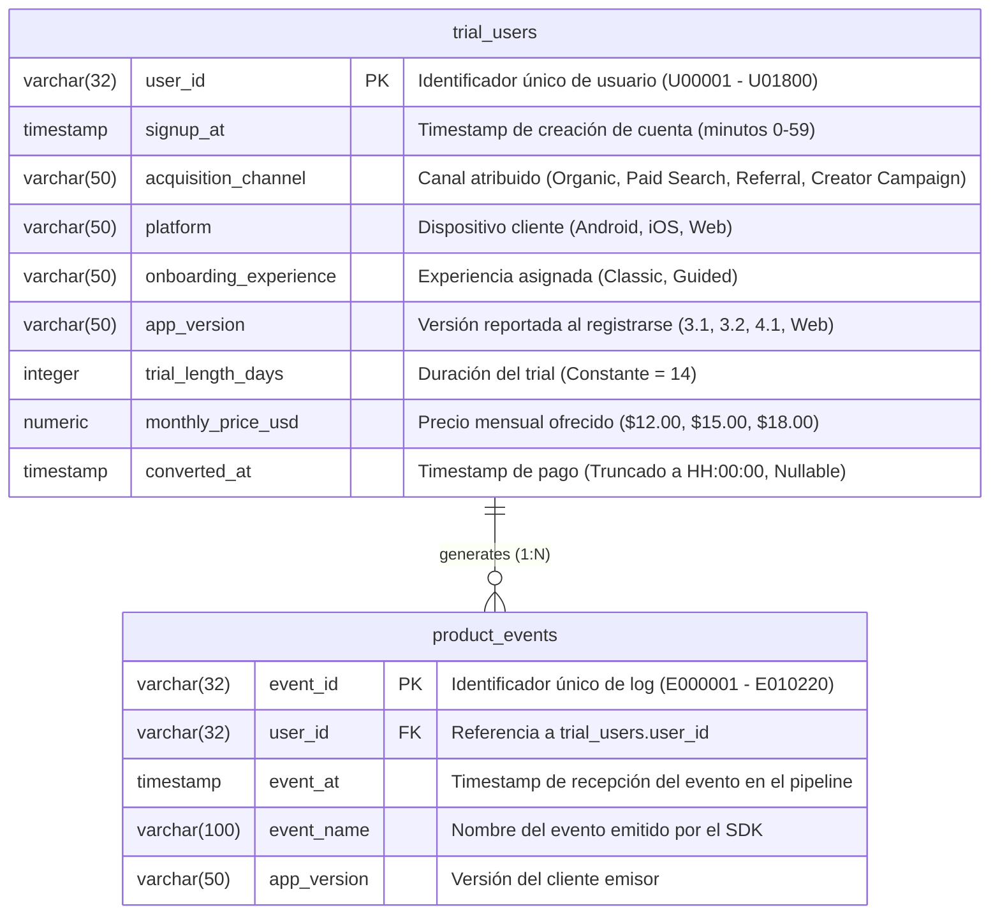

# 🛠️ TaskNest: Technical Data Understanding Brief & Engineering Assumptions

**Documento Técnico de Comprensión del Dato y Arquitectura de Telemetría**  
**Rol:** Senior Data Engineer / Analytics Engineer  
**Entorno de Datos:** PostgreSQL 16 (`tasknest` DB)  
**Fecha:** Noviembre 2026  

---

## 1. Arquitectura del Modelo de Datos (Capa Raw)

La ingesta procesa dos tablas relacionales en un esquema relacional normalizado $1:N$:



---

### A. Especificación Forense de Campos: `trial_users` (1,800 filas)

* **Volumen:** 1,800 registros únicos. Integridad de clave primaria al 100% (cero duplicados, cero nulos en PK).
* **`user_id` (`VARCHAR(32)`):** Formato `U` + 5 dígitos secuenciales (`U00001` a `U01800`).
* **`signup_at` (`TIMESTAMP`):** Rango `2026-04-01 13:03:00` a `2026-08-01 04:32:00`. Posee granularidad a nivel de minutos (segundos en `00`).
* **`acquisition_channel` (`VARCHAR(50)`):** 4 dominios categóricos discretos:
  * `Organic` (615 registros, 34.17%)
  * `Paid Search` (463 registros, 25.72%)
  * `Creator Campaign` (378 registros, 21.00%)
  * `Referral` (344 registros, 19.11%)
* **`platform` & `app_version`:** Mapeo determinístico 1:1 entre plataforma y versión:
  * `iOS` $\rightarrow$ `4.1` (612 usuarios)
  * `Web` $\rightarrow$ `Web` (439 usuarios)
  * `Android` $\rightarrow$ `3.1` (478 usuarios, pre 20-Jun) o `3.2` (271 usuarios, post 20-Jun).
* **`trial_length_days` (`INTEGER`):** Constante $= 14$ días para el 100% de la población.
* **`monthly_price_usd` (`NUMERIC(10,2)`):** Valores discretos: `$12.00` (434 usuarios), `$15.00` (970 usuarios), `$18.00` (396 usuarios).
* **`converted_at` (`TIMESTAMP`, Nullable):** 
  * 1,248 registros `NULL` (69.33% no convertidos).
  * 552 registros con timestamp (30.67% convertidos).

---

### B. Especificación Forense de Campos: `product_events` (10,220 filas)

* **Volumen:** 10,220 eventos de producto vinculados a 1,800 usuarios únicos.
* **Integridad Referencial:** 
  * 0 usuarios huérfanos (el 100% de los 1,800 usuarios tiene al menos 1 evento).
  * 0 eventos huérfanos (el 100% de los eventos apunta a un `user_id` existente).
* **Redundancia de versión:** Discrepancias entre `e.app_version` y `u.app_version` $= 0$. Ningún usuario migró de versión en sus logs de eventos.

#### ⚠️ Patrón Crítico de Eventos (Cardinalidad y Frecuencia):

| `event_name` | Total Eventos | Usuarios Únicos | Eventos / Usuario | Comportamiento en la Data |
| :--- | :---: | :---: | :---: | :--- |
| `trial_started` | 1,800 | 1,800 | **1.00** | Evento de inicialización de prueba (ocurre exactamente 1 vez). |
| `app_open` | 1,800 | 1,800 | **1.00** | Evento de primera sesión (ocurre exactamente 1 vez). |
| `project_created` | 1,247 | 1,247 | **1.00** | Primer proyecto creado (ocurre máximo 1 vez por usuario). |
| `reminder_set` | 412 | 412 | **1.00** | Activación de recordatorio (máximo 1 vez por usuario). |
| `collaborator_invited` | 181 | 181 | **1.00** | Invitación de colaborador (máximo 1 vez por usuario). |
| `task_created` | **4,780** | **1,453** | **3.29** | **Único evento repetible / recurrente del dataset.** |

> [!IMPORTANT]
> **Punto Único de Falla de Telemetría:**  
> Debido a que `task_created` es el **único evento repetible**, cualquier fallo en el SDK cliente sobre este evento destruye el volumen general del log de eventos y desvirtúa cualquier regla de agregación (como la condición corporativa de $\ge 3$ tareas).

---

## 2. Telemetría e Ingesta: Desfases de Reloj, Husos Horarios y Lotes de Pago

### A. Timestamp Jitter y Desfase de Zona Horaria (Clock Skew)
Existen **1,928 eventos** donde `e.event_at < u.signup_at`.

```
signup_at (DB Usuarios)
       │
   ────┼────────────────────────────────────────────────────────►
       │◄─── [-14.88 hrs] ────────────── [0.0 hrs] ───────────── [+14.33 hrs] ───►
                                     event_at (Log SDK)
```

* **Rango del delta (`event_at - signup_at`):** $[-14.88\text{ horas}, +14.33\text{ horas}]$.
* **Media global:** $\mu = -0.034\text{ horas}$ ($\approx 0.0$ minutos).
* **Explicación Técnica:** El rango $[-14\text{ h}, +14\text{ h}]$ reproduce los límites teóricos de los husos horarios del planeta (**UTC-12 a UTC+14**).  
  El servidor web que guarda `trial_users` y la cola de telemetría (Kafka/Event Collector) capturan marcas de tiempo sin normalización estricta a UTC en la capa cliente.
* **Regla de Ingeniería:** Al calcular la ventana relativa de 7 días, un filtro estricto `e.event_at >= u.signup_at` descarta eventos tempranos afectados por este clock skew.

---

### B. Truncamiento por Lotes en la Facturación (*Hourly Billing Batch*)
Al auditar los minutos y segundos de los 552 registros de conversión:
* **El 100% (552 de 552) de los registros `converted_at` tienen `minuto = 00` y `segundo = 00` (`HH:00:00`).**
* Esto demuestra que la plataforma de suscripción procesa los cobros a través de un **batch horario / cron job** de facturación.
* Dado que `signup_at` registra minutos arbitrarios ($0$ a $59$), el redondeo al tope de la hora introduce un retardo artificial de entre $1$ y $59$ minutos (o más si hay reintentos de cobro).

---

### C. Auditoría Forense de la Ventana de Atribución de 14 Días

Del total de 552 conversiones registradas:
* **Convierten en $\le 14.000$ días:** **549 usuarios** (99.46%).
* **Convierten en $> 14.000$ días:** **Exactamente 3 usuarios** (0.54%).
* **Tiempo máximo registrado de conversión en toda la base de datos:** **`14.2604` días** (14 días + 6 horas y 15 minutos). No existe ningún usuario que convierta a los 15, 20 o 30 días.

#### Los 3 Casos Borde al Detalle:

```sql
SELECT 
    u.user_id,
    u.signup_at,
    e.event_at AS trial_started_at,
    u.converted_at,
    (u.converted_at - u.signup_at) AS diff_from_signup,
    (u.converted_at - e.event_at) AS diff_from_trial_started
FROM trial_users u
JOIN product_events e ON u.user_id = e.user_id AND e.event_name = 'trial_started'
WHERE u.converted_at > (u.signup_at + INTERVAL '14 days');
```

| `user_id` | Cohorte | Exp. | `signup_at` | `converted_at` | Tiempo vs `signup_at` | `trial_started_at` | Tiempo vs `trial_started` |
| :---: | :---: | :---: | :---: | :---: | :---: | :---: | :---: |
| **`U01462`** | Post | Guided | `2026-07-19 18:08:00` | `2026-08-02 20:00:00` | **14d 01h 52m** (14.08d) | `2026-07-20 01:08:00` | **13d 18h 52m** ✅ *(Entra en 14d)* |
| **`U01433`** | Pre | Classic | `2026-05-21 13:56:00` | `2026-06-04 18:00:00` | **14d 04h 04m** (14.17d) | `2026-05-21 22:39:00` | **13d 19h 21m** ✅ *(Entra en 14d)* |
| **`U00963`** | Post | Guided | `2026-06-20 16:45:00` | `2026-07-04 23:00:00` | **14d 06h 15m** (14.26d) | `2026-06-20 15:23:00` | **14d 07h 37m** ❌ *(14.31d)* |

> [!NOTE]
> **Hallazgo de Ingeniería:**  
> Si la ventana de prueba de 14 días se evalúa a partir del evento cliente `trial_started` en vez de la tabla de cuentas `signup_at`, **2 de los 3 usuarios (`U01462` y `U01433`) caen estrictamente dentro del periodo de 14 días**.

---

## 3. Radiografía Técnica del Bug en Android 3.2

### A. Línea de Tiempo y Punto de Corte
* **Último registro de Android 3.1:** `2026-06-20 03:11:00 UTC` (478 usuarios).
* **Primer registro de Android 3.2:** `2026-06-20 14:17:00 UTC` (271 usuarios).
* El despliegue de la versión 3.2 en Google Play Store se completó el **20 de junio de 2026** entre las 03:11 y las 14:17 UTC.

### B. Firma en la Data: Truncamiento del Histograma de Tareas
Distribución de tareas registradas por usuario en Android:

```
Android 3.1 (Baseline Saludable)
0 tareas:  [15.9%]  ███████
1 tarea:   [15.3%]  ███████
2 tareas:  [16.7%]  ████████
3 tareas:  [11.9%]  █████
4 tareas:  [10.3%]  ████
5 tareas:  [14.6%]  ███████
6 tareas:  [15.3%]  ███████

Android 3.2 (Bug de Instrumentación)
0 tareas:  [40.6%]  ███████████████████  (Crecimiento anómalo)
1 tarea:   [33.2%]  ███████████████       (Crecimiento anómalo)
2 tareas:  [17.7%]  ████████
3 tareas:  [ 6.6%]  ███
4 tareas:  [ 1.9%]  █
5 tareas:  [ 0.0%]  (Truncado)
6 tareas:  [ 0.0%]  (Truncado)
```

* En **iOS y Web**, la distribución es uniforme de 0 a 6 tareas (~14% por escalón).
* En **Android 3.2**, la cola derecha ($5$ y $6$ tareas) fue completamente suprimida ($0.0\%$). El 73.8% de los usuarios quedan registrados con $0$ o $1$ tarea.

### C. Colapso del Ratio de Telemetría
* Semanalmente, el ratio de eventos `task_created / project_created` en Android 3.1 oscilaba entre **$3.5\times$ y $5.7\times$**.
* A partir del 20 de junio, en Android 3.2 el ratio colapsó a **$0.33\times$** y nunca superó **$1.8\times$**.

### D. La Paradoja del "Pagador Fantasma"
* En **Android 3.1**, el **67.1%** de los clientes que pagaron (`converted_at IS NOT NULL`) estaban registrados como "activados" ($\ge 1$ proyecto y $\ge 3$ tareas).
* En **Android 3.2**, de los 84 usuarios que pagaron por la app, **78 usuarios (el 92.86%) figuran en la base de datos como "no activados"**.
* **Prueba concluyente:** La actividad real del usuario continuó normalmente (incluso pagaron más), pero el pipeline de telemetría dejó de emitir el evento `task_created`.

---

## 4. Reglas de Modelado y Transformación SQL

Para construir la capa de consumo analítico (Data Marts y Vistas), se establecen los siguientes estándares:

### Regla 1: Ventana de Activación (7 Días)
```sql
-- Reloj relativo individual de 7 días
e.event_at >= u.signup_at 
AND e.event_at <= (u.signup_at + INTERVAL '7 days')
```
* **Condición de Activación:** `COUNT(project_created) >= 1 AND COUNT(task_created) >= 3`.
* **Manejo de Android 3.2:** Toda auditoría de activación técnica debe aislar o flaggear la cohorte `platform = 'Android' AND app_version = '3.2'` como datos corruptos.

### Regla 2: Ventana de Conversión (14 Días)
* **Criterio Estricto (Oficial):**
  `u.converted_at IS NOT NULL AND u.converted_at <= (u.signup_at + INTERVAL '14 days')` $\rightarrow$ **549 conversiones**.
* **Criterio Pragmático (Grace Period):**
  `u.converted_at IS NOT NULL AND u.converted_at <= (u.signup_at + INTERVAL '14.5 days')` $\rightarrow$ **552 conversiones**.

### Regla 3: Censura por la Derecha (*Right-Censoring*)
* La fecha de extracción es `2026-08-07`.
* Para activación (7 días), la data está 100% madura ($31\text{ jul} + 7\text{ días} = 7\text{ ago}$).
* Para conversión (14 días), los usuarios registrados entre el **25 y el 31 de julio (122 usuarios)** no han cumplido sus 14 días. Las cohortes deben marcarse como `is_mature = (signup_at <= '2026-07-24 23:59:59')`.

---

## 5. Recomendaciones de Infraestructura y Calidad de Datos

1. **Contrato de Telemetría (Data Contract):** Forzar validación de esquemas en el gateway del SDK móvil para impedir que una actualización de app altere el disparo de eventos sin advertencia.
2. **Normalización UTC en el Ingestion Layer:** Convertir todos los timestamps del cliente a ISO 8601 UTC en el momento del handshake del servidor, evitando deltas negativos frente a `signup_at`.
3. **Monitoreo de Anomalías (Alertas Automáticas):** Implementar pruebas de volumen en dbt / Elementary que disparen alertas P0 si el ratio `task_created / project_created` desciende por debajo de $2.5\times$.
